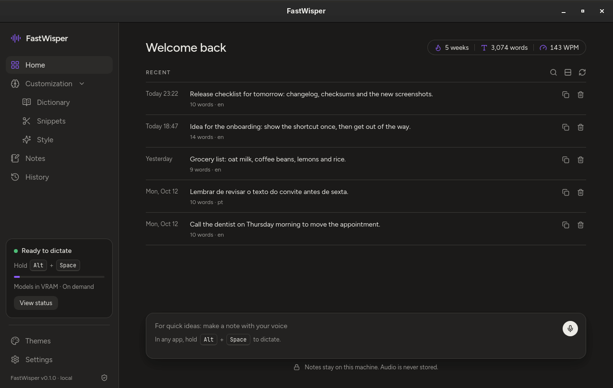
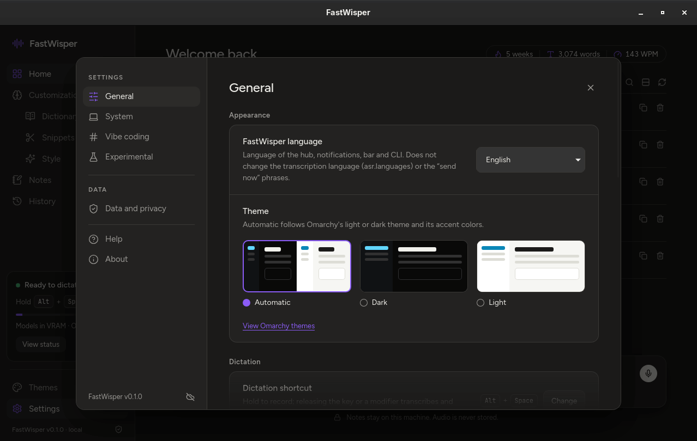
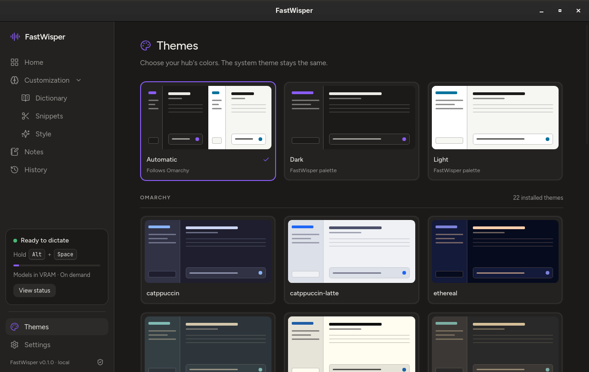
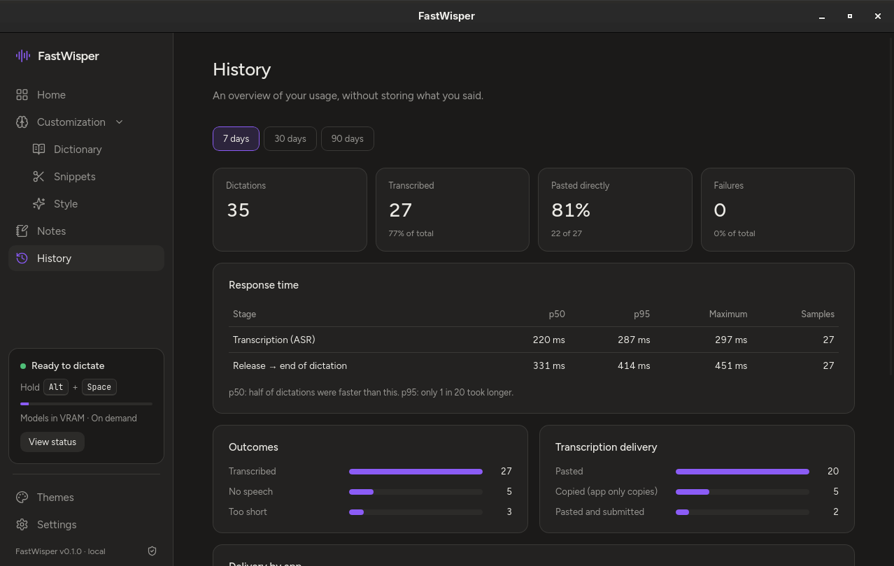
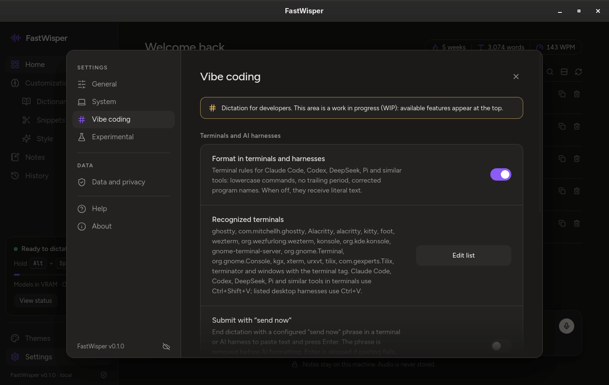

<div align="center">


# FastWisper

**Ditado por voz privado para Linux. Segure uma tecla, fale e solte: o texto aparece no app que você estava usando, e nada sai da sua máquina.**

[](https://github.com/rodrigo-devv/FastWisper/actions/workflows/ci.yml)
[](https://github.com/rodrigo-devv/FastWisper/releases)
[](LICENSE)
[](#requisitos)

[English](README.md) · **Português (Brasil)**



</div>

O FastWisper é um ditado por voz local em português e inglês para o [Omarchy](https://omarchy.org) e o Hyprland, escrito em Rust. O Whisper transcreve na sua GPU ou CPU, regras próprias e um LLM local opcional arrumam o texto, e o resultado é colado na janela que você estava usando. Quando colar não é seguro, o texto fica pronto para copiar. Sem conta, sem assinatura, sem nuvem.

## Por que o FastWisper

- **100% local e privado.** A transcrição roda na sua máquina (whisper.cpp, Vulkan ou CPU), e o LLM opcional roda no seu próprio Ollama, por loopback. Sem conta e sem telemetria. Texto e áudio não são guardados por padrão.
- **Cola só onde você queria.** A janela em que o ditado começou é conferida de novo antes de colar. Se o foco mudou, a tela está bloqueada ou o app é só de cópia, o texto vai para a área de transferência. O FastWisper nunca aperta Enter sozinho.
- **LLM local opcional, que nunca derruba o ditado.** Um modelo local pequeno corrige pontuação e estilo. Se ele demorar, faltar ou escrever algo que você não disse, você recebe o texto das regras: o ditado nunca falha por causa do LLM.
- **Convive com jogos.** Os perfis de VRAM carregam os modelos sob demanda; o perfil automático percebe jogos (GameMode, Steam) e libera a GPU para eles.
- **Feito para vibe coding.** Terminais e assistentes de código ganham formatação que entende comandos, e a frase opt-in "enviar agora" cola e envia o seu prompt sem tocar no teclado.
- **Do seu jeito.** Atalhos editáveis, hub de configuração local, CLI que cobre todas as opções e interface em inglês ou português.

## Começo rápido

No Omarchy, com as [dependências de build](#requisitos) instaladas (uma linha de `pacman`) e `~/.local/bin` no `PATH`, rode num terminal **dentro da sua sessão Hyprland**:

```bash
git clone https://github.com/rodrigo-devv/FastWisper.git && cd FastWisper
packaging/omarchy/install.sh
fastwisper doctor
```

Depois segure **Alt+Space**, fale e solte. Pronto.

O instalador compila o código atual (`cargo build --release`, com Vulkan por padrão), configura o microfone, baixa o modelo de transcrição com checksum fixado, desliga a nuvem do Ollama local, habilita o serviço do usuário e integra os atalhos, o ícone da barra, a pílula de gravação e o hub de configuração. Ele nunca precisa de `sudo` para o FastWisper em si; só pede a senha se um serviço Ollama do sistema precisar ficar offline. As mensagens dele saem em inglês, ou em português quando o seu locale é português (`LC_ALL`, `LC_MESSAGES` ou `LANG` começando com `pt`, por exemplo `LANG=pt_BR.UTF-8 packaging/omarchy/install.sh`). Para atualizar, atualize o checkout e rode o instalador de novo.

<details>
<summary><b>Instalar pelo tarball da release (sem compilar)</b></summary>

A release traz binários prontos (`fastwisper`, `fastwisperd` e `fastwisper-hub`). Baixe o tarball e o `SHA256SUMS` da [página de releases](https://github.com/rodrigo-devv/FastWisper/releases), confira e rode o instalador incluído:

```bash
sha256sum -c SHA256SUMS
tar -xzf fastwisper-0.1.0-x86_64-linux.tar.gz
cd fastwisper-0.1.0-x86_64-linux
./install.sh
fastwisper doctor
```

Guarde a pasta extraída: o `packaging/omarchy/rollback.sh` e o `uninstall.sh` dela desfazem a instalação. Os binários da release são compilados com Vulkan no Arch Linux e caem para a CPU quando não há driver Vulkan funcionando; o `vulkan-icd-loader` continua necessário, porque os binários ligam a `libvulkan.so.1`. Você precisa das ferramentas de uso dos [Requisitos](#requisitos), não das dependências de build.

</details>

<details>
<summary><b>Build só de CPU</b></summary>

Sem cabeçalhos Vulkan nem `shaderc`. Compile os binários e o hub e aponte o instalador para eles; ele instala sem compilar:

```bash
cargo build --release --locked --no-default-features
(cd ui && npm ci && npm run tauri -- build --no-bundle -- --locked)
FASTWISPER_BUILD_DIR="$PWD/target/release" FASTWISPER_HUB_BUILD_DIR="$PWD/ui/src-tauri/target/release" \
  packaging/omarchy/install.sh
```

Sem `FASTWISPER_HUB_BUILD_DIR`, um build externo instala sem o hub.

</details>

<details>
<summary><b>Opções do instalador</b></summary>

- `--offline`: não baixa modelos, e o build do hub usa só o cache do npm/cargo.
- `--no-activate`: só instala arquivos (sem setup, downloads nem ativação).
- `--no-hub`: pula o hub (não remove um hub já instalado).

Elas podem ser combinadas, e o `./install.sh` do tarball aceita as mesmas. Se faltar Node.js/npm ou WebKit, ou se o build do hub falhar, o instalador avisa e o ditado continua funcionando sem o hub. Ele migra sozinho uma integração legada reconhecida e reinicia o shell quando o QML ativo mudou. `fastwisper models pull` sem argumentos baixa o modelo de transcrição configurado; o daemon e o `fastwisper setup` nunca baixam modelos.

</details>

## Uso

| Atalho (padrão) | Ação |
|---|---|
| <kbd>Alt</kbd>+<kbd>Space</kbd>, segurando | Grava; soltar a tecla ou um modificador para, transcreve e cola |
| <kbd>Alt</kbd>+<kbd>Shift</kbd>+<kbd>Space</kbd> | Liga e desliga a gravação mãos livres |
| <kbd>Esc</kbd> durante a gravação | Cancela (fixo) |
| <kbd>Super</kbd>+<kbd>Alt</kbd>+<kbd>V</kbd> | Cola de novo o último resultado na janela com foco |

Terminais recebem <kbd>Ctrl</kbd>+<kbd>Shift</kbd>+<kbd>V</kbd>; os outros apps, <kbd>Ctrl</kbd>+<kbd>V</kbd>. O último resultado fica na RAM por 2 minutos (`fastwisper ctl copy-last` / `paste-last`). A transcrição mantém o idioma em que você falou (português ou inglês) e nunca traduz.

### A pílula de gravação


Enquanto você grava, uma pílula aparece embaixo, no centro do monitor com foco. A onda segue o nível do microfone e se adapta ao ruído de fundo de cada microfone, sem calibração; transcrevendo, ela brilha; se o ditado falhar (microfone ausente ou mudo, por exemplo), ela fica âmbar por 1,5 s e some. Ela nunca rouba foco nem clique e nunca mostra o texto ditado. É o plugin `fastwisper.pill` do shell do Omarchy, alimentado por `fastwisper meter --follow`: um número entre 0 e 1 por quadro (~25 Hz), só durante a gravação. Nenhum áudio sai do daemon. Para escondê-la: `fastwisper config set overlay.enabled false`.

### Terminais e assistentes de código

Claude Code, Codex e ferramentas parecidas rodando no Ghostty, Kitty, Alacritty e outros terminais são reconhecidos pelo terminal (classe da janela, tag `terminal` do Hyprland ou executável). Com `llm.format_in_terminals = true` (o padrão):

- Um **comando curto** (até 12 palavras, numa linha, sem ser pergunta) que começa por um programa conhecido sai como comando: minúsculas, sem ponto final e com o nome do programa corrigido (por exemplo "git status", "cargo build --release").
- **O resto é texto**, formatado como em qualquer outro app, com maiúscula e pontuação.
- **A sua fala é sempre ditada, nunca obedecida.** Um pedido como "escreve uma função que soma dois números" é digitado como você disse, não respondido. Se a saída do LLM acrescentar código, uma introdução ou palavras que você não disse, o FastWisper usa o texto das regras. Ditados muito longos (mais de 2.400 caracteres) não passam pelo LLM.

Assistentes com janela própria usam <kbd>Ctrl</kbd>+<kbd>V</kbd>; liste as classes deles em `inject.harness_apps` para que recebam a mesma formatação (veja [Configuração](#configuração)).

### "Enviar agora" (opt-in)

Termine um ditado num terminal ou assistente de IA com **"enviar agora"** (ou "send now" em inglês) e o FastWisper cola o texto e aperta **um Enter** por você. Vem desligado: ligue em Configurações › Vibe coding ou com `fastwisper config set inject.send_now true`.

- A frase sai antes do LLM; maiúsculas, acentos e pontuação final não importam. Em outros apps ela fica como texto comum.
- O Enter só vai depois de uma colagem aceita, 200 ms depois, para a mesma janela, ainda com foco e com a tela desbloqueada. Nunca em modo só cópia, depois de troca de foco, com fallback de área de transferência nem no `paste-last`/`copy-last`.
- Depois de uma negação ("não vou enviar agora", "don't send now"), nada é enviado: o texto inteiro é colado sem Enter. Se sobrar só a frase, nada é colado nem enviado.
- As frases são configuráveis por idioma: `fastwisper config set inject.send_now_phrases '{ pt = ["enviar agora"], en = ["send now"] }'` (até 16 frases por idioma, 64 caracteres cada, só letras, números e espaços; lista vazia desliga aquele idioma). Valem as frases de todos os idiomas de `asr.languages`. Escolha frases que não terminem as suas frases normais.

### O hub

`fastwisper hub` abre o hub de configuração local, também disponível no lançador de apps e no clique direito do ícone da barra.

<table>
  <tr>
    <td width="50%"></td>
    <td width="50%"></td>
  </tr>
  <tr>
    <td align="center">Configurações › Geral</td>
    <td align="center">Temas</td>
  </tr>
  <tr>
    <td width="50%"></td>
    <td width="50%"></td>
  </tr>
  <tr>
    <td align="center">Histórico (só métricas, nunca texto)</td>
    <td align="center">Configurações › Vibe coding</td>
  </tr>
</table>

As capturas mostram o hub em inglês, o idioma padrão; em português os mesmos itens aparecem traduzidos.

- **Início:** sequência de semanas (só ditados transcritos), palavras e PPM, notas de voz recentes e o composer de notas.
- **Personalização:** Dicionário, Snippets e Estilo.
- **Configurações:** Geral (idioma, tema, atalhos, microfone, sons e pílula), Sistema (transcrição na GPU ou na CPU, IA, VRAM e manutenção), Vibe coding, Experimental, Dados e privacidade, Ajuda e Sobre. Os campos mostram "Padrão: X" quando o seu valor é diferente do padrão; os que exigem reinício mostram um botão para reiniciar.
- **Histórico:** métricas de uso em 7, 30 ou 90 dias: contagens, latência p50/p95 e entregas por classe de app. Nunca texto.
- **Temas:** Automático, Escuro, Claro e as paletas do Omarchy instaladas; a escolha muda só as cores do hub, na hora.

Atalhos diretos: `fastwisper hub inicio|notas|historico|temas|personalizacao|dicionario|snippets|estilo` abre uma página; `fastwisper hub configuracoes|geral|sistema|vibe-coding|experimental|privacidade|ajuda|sobre` abre uma aba das configurações. Passe **um** nome por comando. Se o hub não estiver instalado, `fastwisper hub` explica o motivo (`--no-hub`, falta de `node`/`npm` ou `webkit2gtk-4.1`, build com falha ou build externo sem o hub).

O hub usa fontes e ícones locais e uma CSP estrita, e o webview dele não tem acesso à rede. Ele nunca mostra o texto do ditado comum nem títulos de janela.

### Notas de voz (experimental, opt-in)

Desligadas por padrão (`experimental.notes = false`). Ligue em Configurações › Experimental ou com `fastwisper config set experimental.notes true`. No composer do Início, clique no microfone para começar e de novo para salvar; Esc cancela. Cada nota pode ser copiada ou apagada, e a lista tem busca, visão compacta e atualização.

As notas são o único texto que o FastWisper guarda: em `$XDG_STATE_HOME/fastwisper/notes/notes.sqlite` (fallback `~/.local/state/fastwisper/notes/notes.sqlite`), arquivo `0600` num diretório `0700`, separado das métricas e criado só no primeiro salvamento. **Áudio nunca é guardado, e o ditado do Alt+Space continua sem guardar texto.** Começar uma nota não apaga o seu último ditado. `fastwisper notes list` lista as notas; `fastwisper notes clear` apaga todas depois de confirmar (`--yes` em scripts). Desligar o recurso esconde as notas, mas mantém o banco. As notas passam pelas mesmas regras e formatação do ditado: se você consentiu com um provedor remoto, ele também pode receber o texto da nota.

## Configuração

Tudo pode ser mudado no hub ou pela CLI. A config fica em `~/.config/fastwisper/config.toml` (ou `$XDG_CONFIG_HOME/fastwisper/config.toml`); veja o [exemplo comentado](config/config.example.toml).

```bash
fastwisper config list                          # todas as chaves, e o padrão quando diferente
fastwisper config get llm.model
fastwisper config set llm.style formal          # valida, preserva comentários, aplica na hora
fastwisper config set hotkey.dictate SUPER+D    # vários pares de uma vez: CHAVE VALOR CHAVE VALOR
fastwisper config reload                        # depois de editar o arquivo à mão
fastwisper restart                              # para chaves lidas só na partida
```

Uma config inválida é recusada e a anterior continua valendo. As chaves que só valem depois de reiniciar (endpoint/engine/consentimento do LLM, modelo/GPU/threads do Whisper, `hotkey.min_recording_ms`) são sinalizadas.

<details>
<summary><b>Idioma, microfone e transcrição</b></summary>

- **Idioma do FastWisper:** `ui.language = "en"` (padrão) ou `"pt-BR"`, em Configurações › Geral ou com `fastwisper config set ui.language pt-BR`. Muda o hub na hora e, depois de um reload, as notificações, a barra/pílula e a saída humana da CLI. Não muda `asr.languages = ["pt", "en"]` (os idiomas aceitos na transcrição) nem as frases do "enviar agora".
- **Microfone:** `fastwisper audio sources` lista os nós do PipeWire; `fastwisper setup --device NOME_DO_NO` escolhe um exato. Sem isso, o setup usa o padrão do sistema; ambiguidade é erro. O FastWisper nunca troca de microfone em silêncio. `fastwisper audio test` grava alguns segundos e mostra o nível (nada é transcrito nem colado); `fastwisper audio test-sound` toca os sons de início e fim.
- **Transcrição na GPU ou na CPU:** `asr.gpu = "auto"` prefere GPUs Vulkan dedicadas; `"cpu"` nunca abre o driver da GPU. Também aceita o nome ou o índice de uma GPU Vulkan (`fastwisper gpus` lista as disponíveis). O `fastwisper setup` escolhe o modelo de GPU (`large-v3-turbo-q5_0`) ou o modelo mais leve de CPU (`small-q5_1`); `fastwisper models use ID` troca de modelo pelo manifesto.

</details>

<details>
<summary><b>Atalhos</b></summary>

Em Configurações › Geral › Ditado (Mudar → pressione a combinação → prévia → Salvar; Restaurar padrão por linha), ou `fastwisper config set hotkey.dictate|hotkey.hands_free|hotkey.paste_last COMBINAÇÃO`. Formato: modificadores (`SUPER`, `CTRL`, `ALT`, `SHIFT`) mais uma tecla, com ao menos um modificador além do Shift; tecla sozinha ou Shift+tecla é recusada porque o Hyprland engoliria o que você digita. Os três atalhos precisam ser diferentes, e o Esc é fixo.

Antes de salvar, o FastWisper lê `hyprctl binds -j`: se outro programa usa a mesma combinação, ele avisa e pede confirmação (`--yes` em scripts). A mudança vale na hora: `$XDG_DATA_HOME/fastwisper/hotkeys.conf` é regenerado e o Hyprland recarrega. `fastwisper hotkeys list|check|apply|keys` mostra, confere sem gravar, regenera e lista as teclas aceitas. Recarregar o Hyprland com uma gravação segurada a cancela (nada é colado).

</details>

<details>
<summary><b>Formatação por LLM (local ou remoto)</b></summary>

- **Local (padrão):** o seu Ollama em `http://127.0.0.1:11434`. Qualquer modelo instalado pode ir em `llm.model`; recomendamos `qwen3:4b-instruct` (`fastwisper ollama models` lista os seus). Um modelo fora do pin só gera aviso. `llm.enabled = false` usa só as regras; `llm.style` é `formal`, `casual`, `very_casual` ou `excited`.
- **Provedor remoto, opt-in:** `llm.engine = "openai_compatible"`, um endpoint HTTPS, um modelo e `llm.remote_consent = true`. Informe a chave com `llm.api_key_file` (arquivo `0600`) ou `llm.api_key_env` no ambiente do serviço. O provedor só recebe o texto a formatar, nunca áudio, títulos de janela ou classes de app. Sem o consentimento, um endpoint fora do loopback é recusado.

</details>

<details>
<summary><b>Apps, terminais e assistentes de IA</b></summary>

- `inject.paste_apps = ["*"]` permite colar em qualquer app validado; uma lista restringe os destinos. `inject.copy_only_apps` tem precedência e deixa esses apps só com cópia.
- Terminal não reconhecido? Defina `inject.terminal_apps` ou dê à janela a tag `terminal` do Hyprland.
- `inject.harness_apps` (vazio por padrão) aplica a formatação de terminal a assistentes de IA com janela própria, sem mudar o atalho de colar. Acrescente só classes/executáveis confirmados na sua sessão, nunca títulos, e não use `electron`, que casa com muitos apps sem relação: `fastwisper config set inject.harness_apps '["CLASSE_CONFIRMADA"]'`. Também fica em Configurações › Vibe coding › Editar lista.
- `llm.format_in_terminals = false` cola o texto literal em terminais e assistentes.

</details>

<details>
<summary><b>Perfis de VRAM e modo jogo</b></summary>

`fastwisper vram` mostra o perfil e o uso de memória; `fastwisper vram automatico|desempenho|sob_demanda|jogo` troca e salva o perfil. O padrão automático funciona como "sob demanda" (modelos descarregados depois de 5 minutos ocioso, `performance.unload_after_secs`) e passa para o modo jogo enquanto houver um jogo aberto: os modelos carregam no aperto da tecla e são liberados logo depois do ditado. `fastwisper ctl unload` libera os modelos na hora.

</details>

<details>
<summary><b>Pílula e tema do hub</b></summary>

- `fastwisper config set overlay.enabled false` esconde a pílula a partir da próxima gravação; `true` mostra de novo. `overlay.position` por enquanto só aceita `"bottom"`.
- `fastwisper config set hub.theme auto|dark|light|omarchy:<nome>` (padrão `auto`, que segue o tema do Omarchy, ou escuro sem ele). A galeria lê `colors.toml` de `/usr/share/omarchy/themes/` e `~/.config/omarchy/themes/`, com prioridade para os seus temas. Se o tema sumir, o hub usa o Automático e guarda a sua escolha para quando ele voltar.

</details>

## Privacidade

**O que fica na sua máquina:** o áudio, transcrito localmente e nunca gravado em disco; o último resultado, na RAM por 2 minutos para você colar de novo; as métricas de uso (contagens, tempos, classe do app, nunca texto); e, só se você ligar, as suas notas de voz.

**O que nunca sai dela:** áudio, nunca. Texto, a menos que você configure e consinta explicitamente com um provedor remoto de LLM, que então recebe só o texto a formatar.

- "Apagar o histórico de uso" e "Apagar todas as notas" (em Dados e privacidade, ou `fastwisper history clear` / `fastwisper notes clear`) removem as linhas com `secure_delete` do SQLite, fazem checkpoint do WAL e rodam `VACUUM`.
- A entrada da área de transferência é marcada como sensível, e o histórico de clipboard do Omarchy não a guarda; outros gerenciadores de clipboard ainda podem guardar cópias.
- Quando o kernel suporta, o daemon usa Landlock para limitar as próprias conexões TCP à porta do LLM. Isso não cobre o processo separado do Ollama.
- Por padrão, o FastWisper desliga a nuvem do Ollama local (`llm.ollama_cloud = false`): `fastwisper ollama apply` (rodado pelo instalador) ou `fastwisper ollama offline` acrescenta `OLLAMA_NO_CLOUD=1` a um drop-in do serviço do Ollama e o reinicia; `fastwisper ollama online` desfaz; `fastwisper ollama` mostra a configuração e o estado real, também conferidos pelo `fastwisper doctor`. O daemon em si nunca mexe no Ollama.
- A página Sobre do hub tem links para o repositório e o desenvolvedor. Eles só abrem no navegador quando você clica; o hub em si não faz requisições a eles.

## Requisitos

- **Desktop:** [Omarchy](https://omarchy.org) com Hyprland 0.56+ (config Lua), sessão Wayland, PipeWire/WirePlumber e um microfone funcionando. Outras instalações do Hyprland podem funcionar, mas não são testadas.
- **Transcrição:** GPU com driver Vulkan (`vulkan-radeon` para AMD, `vulkan-intel` para Intel, `nvidia-utils` para NVIDIA) e `vulkan-icd-loader`, ou só a CPU. Com `asr.gpu = "cpu"`, o setup escolhe o modelo de CPU desde que a config ainda tenha o modelo de fábrica e ele não tenha sido baixado; um modelo escolhido por você ou já baixado nunca é trocado.
- **Ferramentas de uso:** `wl-clipboard`, `libnotify` e `jq`.
- **Opcional, formatação por LLM:** [Ollama](https://ollama.com) local com um modelo instalado por você (`ollama pull qwen3:4b-instruct`). Sem ele, o FastWisper usa as regras próprias, e o `fastwisper doctor` mostra um aviso, não um erro.
- **Opcional, hub de configuração:** `webkit2gtk-4.1` (com GTK 3). Sem ele, o ditado funciona e o hub fica de fora.

Para compilar do código: Rust estável 1.89+ (`rustup`), toolchain C/C++, `clang`, `cmake`, `pkgconf`, `git` e os arquivos de desenvolvimento de PipeWire, ALSA e Vulkan (`vulkan-headers`, `shaderc`); o hub também pede Node.js e npm. No Omarchy/Arch:

```bash
sudo pacman -S --needed base-devel rustup clang cmake pkgconf git \
  pipewire alsa-lib vulkan-headers vulkan-icd-loader shaderc \
  wl-clipboard libnotify jq webkit2gtk-4.1
command -v npm >/dev/null || sudo pacman -S --needed npm  # só puxa o nodejs se não houver Node.js (ex.: nodejs-lts-*)
rustup default stable
```

Para rodar os testes (`cargo test --workspace` e os de pacote), instale também `lua`, `python`, `socat` e `iproute2`: `sudo pacman -S --needed lua python socat iproute2`.

## Solução de problemas e perguntas frequentes

Comece por estes dois:

```bash
fastwisper doctor
journalctl --user -u fastwisperd
```

<details>
<summary><b>Nada acontece quando seguro Alt+Space</b></summary>

Rode `fastwisper doctor` e confira os avisos do instalador. Se o seu `bindings.lua` já liga a mesma combinação, o instalador não mexe no seu bind e os dois disparam juntos: escolha outro atalho com `fastwisper config set hotkey.dictate SUPER+D` (ou em Configurações › Geral › Ditado) ou remova o seu. O instalador precisa rodar dentro da sessão Hyprland para validar os atalhos.

</details>

<details>
<summary><b>O texto só é copiado, não colado</b></summary>

O FastWisper copia em vez de colar quando o foco mudou durante o ditado, a tela está bloqueada, não havia janela com foco ou o app está em `inject.copy_only_apps` (ou fora de `inject.paste_apps`). Uma notificação diz qual foi o caso. Para um terminal não reconhecido, defina `inject.terminal_apps` ou a tag `terminal` no Hyprland.

</details>

<details>
<summary><b>Microfone ou modelo ausente</b></summary>

Confira `fastwisper audio sources`, a config e os avisos do doctor. Um microfone que só entrega silêncio digital gera um aviso de "microfone mudo". Para preparar o modelo de transcrição, rode `fastwisper models pull`. Instale o modelo do LLM no seu Ollama você mesmo (`ollama pull qwen3:4b-instruct`).

</details>

<details>
<summary><b>Driver de GPU com problema?</b></summary>

O FastWisper testa o driver Vulkan num processo separado antes de usar a GPU. Se o driver travar ou cair, o ditado continua na CPU (mais lento), você recebe uma notificação e o `fastwisper doctor` mostra o motivo. Corrija ou atualize o driver e rode `fastwisper restart`. Para não usar a GPU, use `asr.gpu = "cpu"`.

</details>

<details>
<summary><b>O jogo engasga com o FastWisper carregado</b></summary>

Use `fastwisper vram jogo` ou mantenha o padrão `automatico`, que detecta jogos e libera a VRAM. `fastwisper ctl unload` libera na hora.

</details>

<details>
<summary><b>Nuvem do Ollama e isolamento de rede</b></summary>

Para um serviço Ollama do sistema, deixá-lo offline exige `sudo` num terminal, ou a janela de senha do polkit com `--pkexec` (o caminho que o hub usa, em Configurações › Dados e privacidade). O doctor mostra o Landlock ativo com ABI/portas, ou indisponível. Quando suportado, ele restringe as conexões TCP do daemon à porta do endpoint do LLM; não restringe IPs nessa porta, UDP/DNS nem o sistema de arquivos. Um kernel sem suporte gera aviso e o daemon continua rodando.

</details>

<details>
<summary><b>O FastWisper funciona fora do Omarchy?</b></summary>

O alvo é o Omarchy com Hyprland 0.56+ e config Lua; o ícone da barra e a pílula são plugins do shell do Omarchy. Outras instalações do Hyprland podem funcionar, mas não são testadas, e o instalador sai com erro quando falta o shell do Omarchy.

</details>

## Limitações conhecidas

<details>
<summary>O que funciona diferente do que você talvez espere na v0.1.0</summary>

- **Isolamento do Ollama:** o Ollama é um processo separado, fora das restrições Landlock do daemon. `llm.ollama_cloud = false` define `OLLAMA_NO_CLOUD=1`, mas as consultas DNS e verificações de atualização do próprio Ollama fogem do controle do FastWisper.
- **Layouts de teclado:** atalhos com letras ou pontuação supõem a posição de tecla US/ABNT2; AZERTY, Dvorak e outros layouts não foram validados. Enquanto você grava um atalho novo no hub, os binds globais do compositor continuam disparando.
- **Tempo do "enviar agora":** cancelar não interrompe os ~200 ms entre a colagem e o Enter; o intervalo é fixo e não comprova que o app consumiu a colagem. Desligar o opt-in no meio de um ditado cola sem a frase e sem Enter.
- **Apagar histórico ou notas:** a exclusão não garante remoção física em SSDs (wear leveling/TRIM), em sistemas de arquivos copy-on-write (btrfs, o padrão do Omarchy), em snapshots, backups ou swap. Use criptografia de disco inteiro se isso importa para você.
- **Atalho já ligado:** se o seu `bindings.lua` já liga o atalho do FastWisper, o instalador avisa e não mexe no seu bind, então os dois disparam juntos.
- **Ajuda em inglês:** a Ajuda abre o README instalado em inglês (sem imagens), mesmo com `ui.language = "pt-BR"`.
- **Cobertura de hardware:** o uso diário foi numa configuração só (GPU NVIDIA com Vulkan e microfone USB). AMD, Intel e só CPU são cobertos por testes, não por uso diário. A pílula não foi exercitada com vários monitores, outras escalas ou barra embaixo.
- **Acessibilidade do hub:** ainda não verificada com leitor de tela nem navegação só por teclado no WebKitGTK real; a galeria de temas usa uma parada de Tab por cartão.
- **Retorno do `fastwisper hub`:** o comando não espera o hub e informa sucesso mesmo se o hub morrer ao abrir; um hub antigo continua instalado depois de `--no-hub` ou de um build do hub com falha.
- **Avisos de reinício conservadores:** mudar o endpoint do LLM junto com `llm.model` ou `llm.enabled` deixa os dois para o reinício.
- **Streams contínuos:** `fastwisper meter --follow` e `fastwisper status --follow` só percebem uma saída fechada na próxima escrita (a pílula é coberta à parte).
- **Pílula depois de rollback/uninstall:** reinstalar a mesma pílula depois de uninstall e restart pode deixá-la descarregada até o próximo restart do shell; um aperto curtíssimo que vai direto para transcrevendo usa as configurações anteriores da pílula.
- **Ollama offline sem terminal:** sem terminal, `fastwisper ollama apply` (e o `install.sh` sem TTY) abre o polkit em vez de falhar com os comandos `sudo`; a janela do polkit mostra `/bin/sh`.
- **Rótulos do bench:** `fastwisper bench` e `fastwisper transcribe` imprimem alguns rótulos em português mesmo com `ui.language = "en"`.
- **Casos extremos aceitos:** um `HOME` com `$` ou crase no `Exec` da entrada de desktop; config com modo `0o0xx`; um FIFO no lugar do `hotkeys.conf`; o lado Lua aceita `ESC` como nome de tecla (só recusa `ESCAPE`).
- **Detalhes do hub:** `vram_mb = 0` aparece como "—"; o total de VRAM fica vazio se o `nvidia-smi` falhar na primeira chamada; "Liberar VRAM" fica habilitado com o daemon parado (termina num aviso de erro).
- **Editores de personalização:** o editor de substituições sobrescreve uma entrada existente sem avisar; a checagem de duplicatas do editor de listas diferencia maiúsculas. Apagar uma nota com id inexistente informa `deleted: 0`.
- **Caminho genérico das configurações:** o comando genérico de configurações do hub aceita `hotkey.*` sem a confirmação de conflito do editor de atalhos (a interface não usa esse caminho).
- **Hub com config própria do daemon:** o hub sempre grava no arquivo de config padrão. Se você iniciar `fastwisperd --config` com outro arquivo, uma troca de modo de VRAM pelo hub chega ao daemon, mas é salva no arquivo padrão.

</details>

## Desinstalar e voltar versão

<details>
<summary>Comandos</summary>

Rode a partir do checkout do código ou da pasta extraída da release. Para remover a integração:

```bash
systemctl --user disable --now fastwisperd.service
omarchy plugin disable fastwisper.dictation
omarchy plugin disable fastwisper.pill
packaging/omarchy/uninstall.sh
systemctl --user daemon-reload
hyprctl reload
```

Para voltar uma geração instalada:

```bash
packaging/omarchy/rollback.sh
systemctl --user daemon-reload
systemctl --user restart fastwisperd.service
hyprctl reload
```

O `uninstall.sh` também remove o hub. Rollback e uninstall só restauram arquivos que ainda batem com o que foi instalado, e mantêm a sua config, os modelos e edições externas. O rollback trabalha no disco: se o QML mudou, rode `omarchy-restart-shell` para atualizar a barra e a pílula. A config (`~/.config/fastwisper/`), os modelos (`~/.local/share/fastwisper/models/`) e o estado, como histórico de uso e notas (`~/.local/state/fastwisper/`), continuam no lugar; apague à mão se quiser começar do zero.

</details>

## Roadmap

- Pacote no AUR.
- Validação mais ampla: GPUs AMD e Intel no uso diário, vários monitores e escalas para a pílula, mais layouts de teclado.
- Acessibilidade do hub: leitor de tela e navegação só por teclado.
- Ajuda no idioma da interface.

Ideias e relatos de bug são bem-vindos nas issues.

## Contribuindo

Contribuições são bem-vindas! Veja o [CONTRIBUTING.md](CONTRIBUTING.md) (em inglês) para compilar e rodar as checagens. Relate problemas de segurança em particular, como descrito no [SECURITY.md](SECURITY.md). O projeto segue o [Contributor Covenant](CODE_OF_CONDUCT.md). O [changelog](CHANGELOG.md) registra o que mudou em cada versão.

## Licença

[MIT](LICENSE)
